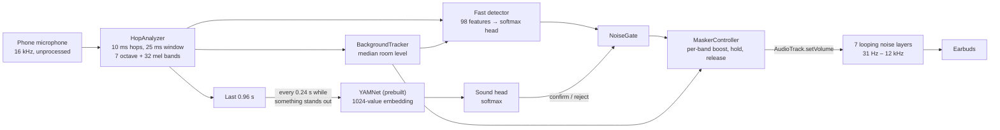

# Architecture

Quiet Night cannot cancel noise acoustically. Bluetooth adds roughly 150–300 ms between the phone and the ear, and an app cannot reach the earbuds' own noise-cancelling microphones, while anti-phase cancellation needs well under a millisecond. The app therefore masks: a quiet noise plays all night and, when the microphone hears a cat, motorcycle or car, the bands that sound occupies rise just enough to cover it, then fade back.

## Two detection stages

The fast detector decides from a single 10 ms hop whether a rise looks like a target noise. Two agreeing hops open the gate, so the masker reacts within 20–30 ms of a sound reaching the microphone. YAMNet, Google's AudioSet model, runs only while something stands out from the room. Its 1024-value embedding goes through a trained head that confirms a cat, motorcycle or car, which keeps the gate open for 8 s because these noises come in runs, or rejects the sound, which silences the fast detector for 1.5 s.

## Masking

Each of the seven octave bands rises by how far the room's level in that band is exceeded, minus the bedtime headroom, plus a 3 dB margin, up to the user's strongest boost. A boost holds for 3 s and then fades at 3 dB/s, so the masker swells and settles instead of pumping with each meow. Each band is a looping, seamless noise layer on its own `AudioTrack`; a boost changes the track volume, which Android's mixer applies on its next cycle, so half a second of buffered audio never delays a boost.

## Training

Both heads are multinomial logistic regressions trained by the same C# code in three places:

- `QuietNight.Trainer` builds the bundled heads from the training split of the reference sounds.
- The **Train** tab fine-tunes them on the phone from the user's recordings, mixed into their room at 10, 18 and 26 dB, together with replayed reference examples and a pull back towards the previous weights. The new heads are kept only when they do better on held-back parts of the recordings without losing more than 3 points on the reference sounds.
- The tests check that this fine-tuning learns new examples without forgetting.

`ExampleBuilder` labels examples the way the app hears them: a sound is laid over a room after four seconds of quiet, and a hop counts as the sound's class only where the sound alone stands out from both its own quiet parts and the room.
