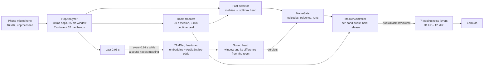

# Architecture

Quiet Night masks rather than cancels. Bluetooth adds roughly 150–300 ms between the phone and the ear, and an app cannot reach the earbuds' own noise-cancelling microphones, while anti-phase cancellation needs well under a millisecond. A quiet noise therefore plays all night and, when the microphone hears a cat, motorcycle or car, the bands that sound occupies rise just enough to cover it, then fade back.

`NightListener` runs this path for every 10 ms hop. The app runs YAMNet on a background thread and hands each verdict back to the listener.

## The room

Two trackers follow the room in each band from histograms of recent levels:

- The **30 s median** is what "standing out" is measured against. It is frozen while a sound is being masked, for at most two thirds of any 30 s, so a long sound eventually becomes the room.
- The **bedtime peak** is the room's 90th percentile over the last five minutes. It takes in brief swells such as drips or crickets, but not sounds that stand out for more than half a second, nor a sound standing out from the median that is already louder than the bedtime masker covers. The user sets the masker's volume at bedtime so the room cannot be heard. The masker's fixed spectral tilt, anchored at the band where the room peaks highest, plus 6 dB of headroom, is therefore what the bedtime masker already covers. A sound **needs masking** when any band exceeds that cover.

While the room is quiet, the sound model also takes a fresh look at it every 10 s and averages YAMNet's view of the room.

## Two detection stages

The **fast detector** judges each hop from how far each mel band rises above the room, how quickly it rose over the last 40 ms, and the spectral shape. When a sound needs masking and two hops in a row look like a target, the gate opens provisionally. The masker therefore reacts within 20–30 ms of the sound reaching the microphone.

The **sound model** is Google's YAMNet with its later layers fine-tuned for this task, run only while a sound needs masking. Its 1024-value embedding and the log-odds of its own AudioSet classes, next to how both differ from the quiet room's, go through a trained softmax head. The first window is taken once the sound fills a quarter of the 0.96 s window; until then the window holds mostly the room before the sound.

## The gate

`NoiseGate` follows each sound as an **episode**. An episode starts when a sound needs masking and ends a second after it stops needing it. Each verdict adds its log-odds of a target to the episode's evidence. Evidence against a target counts only in proportion to how much of the window the sound filled, reaching full weight at half the window.

- **Confirmed** at +2. The sound is masked with the confirmed hold and release, and stays confirmed until the evidence rules it out. From then on, evidence against it counts only as far as the window holds sound that needs masking, so its own pauses do not argue it out. For the next 8 s, a new sound whose rise above the room has the same spectral shape (correlation of at least 0.6 over its first 50 ms) continues the run and is masked at once.
- **Rejected** at −2. The boost falls at 150 dB/s and the sound is left alone. For the next 4 s, a new sound with the same shape is rejected as soon as it is recognised; the gate stays closed while it compares. A rejected sound that grows 10 dB louder than when it was rejected, such as an approaching motorcycle or a cat calling over rain, starts a new episode and is judged afresh.

Which target is named comes from the share each target takes of the target probability in windows that look like targets, with older windows fading. A clear new target is therefore named correctly even after a long run of another.

Noises the user switches off on **Night** count as harmless in the sound model's verdicts, so once the sound model hears one, the gate rejects it and its boost falls away. The fast detector still reacts to every target at onset. Within its first hops it cannot tell a cat from an engine, so a switched-off noise may get a provisional boost until the first verdict.

## Masking

Each of the seven octave bands rises by how far it exceeds the bedtime cover, plus a 3 dB margin, up to the loudest rise the user allows. Lowering that limit during a night caps every band from the next hop; the bedtime levels keep the headroom the night started with. A sustained rise, like an approaching engine, is extrapolated a quarter second ahead so the masker is already loud enough when the earbuds play it.

- A provisional boost holds for 0.5 s and fades at 10 dB/s.
- A confirmed boost holds for 3 s and fades at 3 dB/s, so the masker swells and settles instead of pumping with each meow.

Each band is a looping, seamless noise layer on its own `AudioTrack`. A boost changes the track volume, which Android's mixer applies on its next cycle, so buffered audio never delays a boost.

## Training

The sound model is fine-tuned offline by `training/finetune.py`. It starts from the prebuilt YAMNet and trains its later convolution layers, together with a head like the app's, on 0.96 s windows of the training sounds mixed into training rooms at night levels. Half the windows are only partly filled by the sound, as at an onset, and each is judged next to another window of the same room. Fine-tuning lets the embedding separate cats from fan hums and voices that the prebuilt model places close together.

Both heads are multinomial logistic regressions, trained with AdamW by the same C# code in three places:

- `QuietNight.Trainer` builds the bundled heads from the training split of the reference sounds and reports accuracy on the validation split.
- The **Teach** tab fine-tunes them on the phone. It mixes the user's recordings into their room at 10, 18 and 26 dB and adds replayed reference examples. The last fifth of each recording is held back before any mixing. New heads are kept only when the sound head does at least two points better on the held-back recordings, and neither head loses more than two points there or three points on reference sounds it never trained on.
- The tests check that fine-tuning learns new examples without forgetting.

`ExampleBuilder` labels examples the way the app hears them. A sound is laid over a room after four seconds of quiet, with phone-microphone self-noise, and passes through the same listener. A hop counts as the sound's class only where the sound alone stands out from both its own quiet parts and the room.
